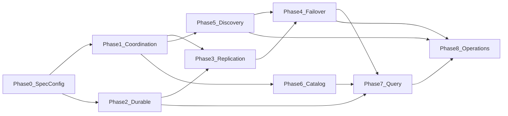

# Implementation WBS: Multi-Node Skippr HLA

**Architecture:** [`hla-distributed-query-iceberg-catalog.md`](./hla-distributed-query-iceberg-catalog.md)  
**Flight SQL / QueryRuntime:** [`hla-flight-sql-query-runtime.md`](./hla-flight-sql-query-runtime.md)  
**Style:** [`AGENTS.md`](../../../AGENTS.md)  
**Boundary:** [`repository-map.md`](./repository-map.md)

This WBS is the implementation contract for clustered disk WAL, failover, the Iceberg DynamoDB catalog, Flight SQL, and QueryRuntime. It supersedes the earlier draft choices for sled leases, custom Flight tickets, configurable quorum, extra cluster knobs, and an Iceberg listing fallback. Shipped vs deferred is recorded in the architecture spec **Implementation status** section: Arrow Flight SQL 59.2, datafusion-distributed, and authenticated Chitchat (WU-5.1) are in tree. Flight SQL / QueryRuntime requirements and design: [`hla-flight-sql-query-runtime.md`](./hla-flight-sql-query-runtime.md).

## Completion rules for every work unit

- Compile-time invariants first: newtypes, enums, exhaustive matches, typed errors.
- No `if cluster` branches through ingest orchestration. Cluster behavior enters through typed factories, lease guard, durable store, offset publisher, and lifecycle.
- No one-implementor trait hierarchy. Traits are justified only by real production backends or deterministic test doubles.
- No process-global pipeline/config lookup from replica/query/catch-up code.
- Default host builds do not pull DynamoDB connector dependencies.
- Feature-gated code compiles in CI.
- No work unit is complete without its named deterministic tests.

## Locked configuration

```rust
pub enum WalStorage {
    Disk,
    S3,
    Clustered,
}
```

- Existing `WAL_STORAGE` / `--wal-storage` only.
- `clustered` reuses the SkipprStore table (`skippr.store.name` / `SKIPPR_STORE_NAME`) for offsets, leases, and membership.
- SkipprLake `catalog_table` is a separate customer-created catalog table. It MUST NOT be the offset table.
- No lease/quorum/TTL/node/bind/peer-list knobs.
- Quorum and replication factor are both two total copies.
- `clustered` forces DynamoDB offsets/checkpoints.
- `clustered sync --once` and clustered discover fail validation.
- `clustered query` never takes an ingest lease. After WU-7.5 it opens Flight SQL on any ready node; that node plans Iceberg∪WAL. WAL is best-effort latest advertised head ([`hla-flight-sql-query-runtime.md`](./hla-flight-sql-query-runtime.md)).
- `disk` and `s3` start no cluster services.

## Dependency graph



## Planned layout

```text
crates/skippr-lease/
crates/skippr-lease-store-dynamodb/
crates/skippr-wal-catalog/
crates/skippr-iceberg-catalog/
crates/skippr-iceberg-catalog-dynamodb/
crates/skippr-query-plan/
proto/cluster.proto
src/cluster/
  identity.rs
  membership.rs
  peer.rs
  placement.rs
  promote.rs
  scheduler.rs
  lifecycle.rs
src/buffer/durable/
  store.rs
  replicate.rs
src/buffer/
  wal_handle.rs
  wal_startup.rs
  wal_catalog_import.rs
src/query_flight/          # Arrow Flight SQL 59.2 on flight_addr; in-process QueryRuntime
  service.rs
  live_wal.rs
src/sqlrt/
  iceberg_table.rs
  flight_sql_table.rs      # FlightSqlExec leaf, not StreamingBatchesExec
  wal_table.rs
```

# Phase 0 — Spec, config, and compatibility gates

## WU-0.1 Typed `WalStorage`

**Touch:**

- [src/helpers/configuration.rs](../../../src/helpers/configuration.rs)
- [src/cli/mod.rs](../../../src/cli/mod.rs)
- [src/buffer/wal_store.rs](../../../src/buffer/wal_store.rs)
- [src/buffer/ingest_buffer.rs](../../../src/buffer/ingest_buffer.rs)
- [src/helpers/offsets.rs](../../../src/helpers/offsets.rs)
- [src/engine.rs](../../../src/engine.rs)
- [src/ingest_work.rs](../../../src/ingest_work.rs)

**Deliverables:**

- Parse `disk|s3|clustered` into an enum.
- Unknown values fail startup.
- Exhaustively replace all string `s3` comparisons.
- Do not add a YAML `wal_storage` field.
- Add a guard test preventing new string comparisons.

**Tests:** enum parsing, CLI precedence, unknown value, every factory branch.

## WU-0.2 Clustered mode validation

**Deliverables:**

- Require existing `offset-store-dynamodb` feature and table.
- Select DynamoDB offsets when unset; reject explicit sled.
- Reject clustered `--once`, discover, AtLeastOnce sink, NonRetryable sink, and duplicate `DATA_DIR` process.
- Add `PipelineConfigView::for_name` for immutable per-pipeline resolution without process-global pipeline identity.

**Tests:** all valid/invalid mode and connector combinations.

## WU-0.3 Documentation synchronization

Update operator/config/concept/README docs with:

- third `WAL_STORAGE` value;
- expanded DDB row families and IAM;
- S3 mode remains non-clustered;
- no extra cluster knobs;
- trusted-private-network requirement;
- two-node durability versus three-node failover write availability.

# Phase 1 — Coordination

## WU-1.1 Identity, clock, and typed errors

**Create:** `crates/skippr-lease`.

```rust
pub struct LeaseEpoch(u64);
pub struct NodeId(uuid::Uuid);
pub struct HostId(String);
pub struct PipelineKey {
    tenant: String,
    workspace: String,
    pipeline: String,
}
```

Catalog sequence is `skippr_wal_catalog::CatalogSeq`, not a lease `CommitIndex`.

**Deliverables:**

- UUID process generation.
- Host ID derived from platform metadata/machine ID/hostname.
- `Clock` and `AsyncSleeper` production/test implementations.
- Typed lease/fence/quorum/store/protocol errors.

**Tests:** deterministic monotonic advance and host-ID fallback.

## WU-1.2 `LeaseGuard` and lifecycle

```rust
pub enum WriteAuthority {
    SingleNode,
    Leased(LeaseSession),
}

pub enum PipelineRole {
    Idle,
    OwnerElect(LeaseSession),
    ActivePrimary(WriteAuthority),
    Replica { epoch_seen: LeaseEpoch },
}
```

**Deliverables:**

- Local monotonic expiry.
- Higher epoch demotes Active/Elect and updates replicas.
- `PipelineLifecycle` watch channel.
- Ingest, compactor, durable store, runtime source, and offsets observe fence.
- Single-node epoch zero path.

**Tests:** role checks, expiry, fence rumor, renew loss, source still producing after fence.

## WU-1.3 Clock-free DDB lease

**Create:** `crates/skippr-lease-store-dynamodb`, included by existing `offset-store-dynamodb` feature.

**Row:**

```text
PK={tenant}#{workspace}#{pipeline}
SK=lease
owner_node, epoch, heartbeat, released, initialized
```

**Protocol:**

- conditional create for missing item;
- conditional renew increments heartbeat;
- contention strongly observes an unchanged owner/epoch/heartbeat for 30 monotonic seconds;
- conditional exact-tuple steal increments epoch;
- release only after successful drain;
- never delete lease row;
- local deadline starts when DDB request starts; late response cannot extend it.

Use a dedicated async DDB client so offset publication cannot starve renew.

**Tests:** 100 concurrent acquires, renew/steal race, late/lost response, throttle, release/reacquire epoch, initialized crash windows.

## WU-1.4 DDB membership

**Row:**

```text
PK={tenant}#{workspace}#cluster
SK=node#{node_uuid}
host_id, addresses, heartbeat, protocol range, capabilities
```

**Deliverables:**

- wildcard/ephemeral listeners;
- advertised private IP derived from route to DDB endpoint;
- exact-PK Query for cold discovery;
- conditional stale-row cleanup after unchanged observation plus failed dial;
- no DDB Scan;
- membership remains hint-only.

**Tests:** stale rows, bad address, generation mismatch, protocol mismatch, same-host exclusion.

## WU-1.5 Conditional clustered offsets/checkpoints

**Touch:**

- [crates/skippr-offset-store-dynamodb/src/lib.rs](../../../crates/skippr-offset-store-dynamodb/src/lib.rs)
- [src/helpers/offsets.rs](../../../src/helpers/offsets.rs)
- [src/buffer/ingest_buffer.rs](../../../src/buffer/ingest_buffer.rs)
- runtime-plugin offset-hint path

**Item metadata:** `wal_epoch`, `wal_commit_index`, `payload_sha256`.

**Deliverables:**

- Strong read, merge sticky Closed/max Position, conditional exact-prior write, retry.
- Checkpoint last-writer ordering by WAL tuple.
- Same tuple/same hash idempotent; same tuple/different hash corruption.
- Older tuple cannot overwrite newer.
- Async/bounded publication on offset worker.
- Strong-consistent reconciliation barrier before source construction.
- Direct clustered offset writes without a committed tuple are rejected.

**Tests:** conditional races, partial multi-key success, failed quorum leaves DDB untouched, crash after quorum before DDB, S3 object skipped after promotion, CDC checkpoint recovery.

# Phase 2 — Durable mutation state

## WU-2.1 Cluster protocol v3 (payload-only)

**Create:** `proto/cluster.proto`. Catalog rows replace the mutation-log hash chain.

Control frames:

```text
Status / StatusOk
AssignReplica
ReplicatePayload
DropPayload
PruneTo
FetchPayload
DropReplica
```

Payload bytes are out-of-band of the catalog `SegmentRow`. Mixed v2 peers are rejected. `CURRENT_PROTOCOL` is 3.

**Tests:** codec/current-previous version, protocol mismatch, payload sha, unknown field/version.

## WU-2.2 Portable refs and `PipelinePaths`

**Touch:**

- [src/buffer/compaction_transaction.rs](../../../src/buffer/compaction_transaction.rs)
- [src/sink_apply_identity.rs](../../../src/sink_apply_identity.rs)
- runtime WAL ref protocol

**Deliverables:**

- Explicit tenant-scoped paths: `{DATA_DIR}/clustered/{encoded_tenant}/{encoded_workspace}/{encoded_pipeline}`.
- Clustered source identity `wal://tenant/workspace/pipeline/segment`.
- No absolute path in clustered manifests, RPCs, hashes, or sink receipts.
- Legacy disk identity/layout remains unchanged in disk mode; migration installs the clustered baseline under the new root.
- Replica paths never call process-global config.

**Tests:** identical compaction ID/fingerprint across different local roots; path-isolation property.

## WU-2.3 WAL catalog write path

**Create:** `wal_handle.rs` + `skippr-wal-catalog`.

Rows:

```text
SegmentRow
SeqRow
ControlRow
CompactionRow
FormatRow
```

**Primary order:**

1. epoch check;
2. payload write/hash/fsync or S3 PUT;
3. clustered replica payload ack;
4. catalog txn (`SegmentRow` + `SeqRow`);
5. `publish_wal_commit`;
6. ingest Ack.

**Recovery:**

- import legacy owned pairs once;
- hydrate RAM from catalog rows;
- republish unpublished rows;
- GC orphan payloads with no row;
- never commit orphan payload by existence.

**Tests:** subprocess crash at every boundary, catalog failpoints, duplicate request, unknown outcome.

## WU-2.4 Catalog applicator

**Create:** `crates/skippr-wal-catalog/src/apply.rs` as the only txn builder.

**Deliverables:**

- Lease-fenced `CatalogTxn` with `NotExists` / `SameSha` / `Version` / `SeqAdvance`.
- Slice-done bit OR on `SegmentRow`.
- Compaction put/delete.
- No mutation log, snapshot, or hash apply.

**Tests:** every catalog op, duplicate commit, condition fail, stale fence.

## WU-2.5 `PipelineWalHandle`

**Create:** `wal_handle.rs`.

**Deliverables:**

- Disk: `PipelineWalHandle` with `PipelinePaths::legacy_disk`, sled catalog and offsets, no network.
- Clustered: leased `PipelineWalHandle`, synchronous payload replica, remote catalog, tenant `PipelinePaths`.
- S3: payload objects plus the same catalog handle.

**Tests:** existing disk behavior parity and factory exhaustiveness.

## WU-2.6 Compaction integration

Replace direct compaction state writes:

1. catalog Pending;
2. catalog Sent;
3. sink call;
4. catalog Acked;
5. slice-done bits;
6. delete CompactionRow, then payload, then DropPayload.

Recovery of Sent calls sink preflight. Clustered connector validation guarantees replay is safe.

**Tests:** sink success/crash before Acked, AlreadyApplied, unsupported sink rejection, completion/reclaim ordering.

## WU-2.7 State snapshots and retention

Deleted. The store catalog is the live set; there is no snapshot-plus-suffix WAL. Payload GC is orphan objects with no `SegmentRow`. Catch-up fetches missing payloads by catalog id.

## WU-2.8 Existing disk migration

Lease-holder-only import in `wal_catalog_import.rs`:

- admit owned `.seg` + `.seg.commit` pairs into `SegmentRow`s;
- fold completion bitmaps into `SliceBitmap` and compaction JSON into `CompactionRow`s;
- log leftover as counts (never path lists); fail closed on unreadable bitmap/JSON with the one filename;
- `FormatRow` Imported → archive leftover (`mutation.log`, snapshots, `done/`, compaction JSON, `.seg.commit`) → Clean;
- clustered protocol v3; mixed v2 peers rejected.

**Tests:** owned pair, payload without marker skipped, leftover archived after import, crash in Imported resumes, unreadable compaction JSON is a short error.

# Phase 3 — Replica protocol and quorum

## WU-3.1 Bounded TCP transport

**Create:** `src/cluster/peer.rs`.

Use protobuf control frames and raw streamed payload chunks:

- 16 MiB metadata cap;
- 1 MiB payload chunks;
- buffer splits oversized metadata before commit;
- bounded queues and one in-flight mutation per pipeline;
- read/write/idle/whole-RPC deadlines;
- partial frame cleanup;
- current and previous protocol negotiation.

RPCs: Status, AssignReplica, ReplicatePayload, DropPayload, PruneTo, FetchPayload, DropReplica.

Handshake `ClientHello` has cluster hash (`ClusterId`), node id, protocol range. No tenant/workspace (`reserved 5, 6, 7`). `CURRENT_PROTOCOL` is 3. Client verifies `HelloOk.cluster_hash` and protocol range. mTLS is required.

Assign: `ready` starts false; unknown pipeline and unparseable `primary_endpoint` Nack. Assign calls `observe_epoch` and records `assigned_primary`. Unassigned or wrong-epoch Replicate Nacks.

**Tests:** split/truncated/oversized frames, slow reader, reconnect, timeout, protocol mismatch, no unbounded allocation.

## WU-3.2 Replica reopening and placement

**Create:** `placement.rs`.

- Reopen local pipeline directories only with valid cluster marker/state.
- Verify/replay before advertising.
- Target one remote replica.
- Rendezvous-rank candidates.
- Exclude same process, same HostId, bad protocol, disk pressure (including unmeasurable free space), corruption.
- Assign/bootstrap before ready ad.
- In-flight peer set is immutable.

**Tests:** deterministic ranking, membership churn, same-host exclusion, restart generation, replacement.

## WU-3.3 Quorum replicator

**Create:** `replicate.rs`.

- Local fsynced payload is vote one.
- One caught-up remote payload Ack is vote two.
- Replica Acks after durable payload fsync and sha verify.
- Lagging/stale/corrupt/disk-full/timeout does not count.
- Timeout/unknown live replicate error: no catalog commit, fence ingest.
- Definite Nack (stale, not caught up, disk full, pinned, diverged): abort payload, no catalog row.
- Catalog SegmentRow + Fresh publish only after payload quorum.

**Tests:** quorum success/loss, stale epoch, gap, hash mismatch, timeout, offset unchanged.

## WU-3.4 Unknown outcome

- Payload without a catalog row is an orphan; startup GC deletes it when Format is Clean.
- Catalog row without publication is republished before ingest activate.
- Without payload quorum, `QuorumLost` and no ingest activate.
- Republish offsets from catalog rows in seq order before source starts.

**Tests:** response loss, primary SIGKILL, promoted replica, idempotent offset repair.

# Phase 4 — Catch-up and promotion

## WU-4.1 Catalog payload catch-up

- Status returns epoch, `catalog_seq_seen`, `payload_ready`.
- Catch-up queries live catalog rows and fetches missing payloads by `segment_id` from any reachable peer, including the old primary.
- Payload reads are not fenced. `PromoteError::PayloadMissing` lists ids no peer still holds.
- `PruneTo { live digest, epoch }` repairs lost `DropPayload`s; replicas ignore a lower epoch and never self-delete.
- No S3 archive or DDB head hint.

**Tests:** empty fetch, 1..N, truncated payload, donor failure/retry, PayloadMissing.

## WU-4.2 Promotion

Sequence:

1. lease acquisition and OwnerElect;
2. higher-epoch rumor;
3. catalog-seq + `payload_ready` catch-up from every reachable peer including the old primary;
4. offset/checkpoint reconciliation (OwnerElect; before activate);
5. schema load/install from object-store `metadata.json` (steal already waited one `LEASE_TIMEOUT`; do not wait again before GET; install plugin schema state; live WAL namespaces must be in the document; initialized pipelines fail closed without it);
6. new remote replica bootstrap;
7. ActivePrimary;
8. source/compactor start.

Initialized payload loss is fatal (`PayloadMissing`).

**Tests:** missed rumor, old renew, PayloadMissing, no head, new head zero, missing metadata.json / live namespace, steal observation is the previous-writer TTL (no second wait), no replacement.

## WU-4.3 Lag/replacement/purge

- Behind node never Acks.
- Catch up in background.
- Healthy replica leaves only after replacement.
- Corrupt replica stops ads and purges only its pipeline.
- Primary loses quorum until replacement.
- Reclaim is not delayed for scans; missing files are skipped.

**Tests:** lag recovery, forced corruption, purge isolation, active scan.

## WU-4.4 Old-primary fencing

- Local deadline and higher epoch stop commits.
- Old quorum commit is either recovered or remains uncommitted.
- Old offset tuple cannot overwrite new.
- Source may keep producing temporarily but every durable path rejects.

**Tests:** partitioned old primary, in-flight flush/sink, late DDB call.

# Phase 5 — Discovery and gossip

## WU-5.1 Live membership (authenticated Chitchat)

**Create:** `src/cluster/gossip.rs` (Chitchat 0.9), `membership.rs` (DDB / Cloud tables cold seeds).

- DDB / Cloud tables Query supplies cold seeds (`add_seeds` / `ChitchatHandle::gossip`).
- Live transport is authenticated Chitchat: HMAC-SHA256 on `ad` / `fence` / `suspect` payloads. `SKIPPR_CLUSTER_GOSSIP_KEY` is required (no tenant-string fallback). Chitchat `cluster_id` is `SKIPPR_CLUSTER_ID`.
- Advertise endpoints, protocol, replica head hint, capacity/readiness. No `ClientHello.role`.
- No partition-level ads.

**Tests:** three-node convergence, stale DDB row, restart generation, bounded payload.

## WU-5.2 Fence/suspicion wiring

- Fence rumor updates guard only.
- Suspicion triggers lease observation only.
- Status is head truth.
- Gossip cannot call lease mutation apply or offsets.

**Tests:** partition, delayed rumor, stale commit hint, DDB CAS still decisive.

## WU-5.3 Trust boundary

- Replica/Flight/QueryRuntime TCP is always mTLS. Gossip UDP is HMAC with a required cluster key.
- Handshake verifies **cluster id** (`cluster_hash`) and protocol, not tenant/workspace.
- Tenant is `PipelineKey` on every replica frame and Flight `Authorization: Basic {tenant}/{workspace}` on every SQL RPC. Cloud JWT stays on the gateway (D31).
- Flight tables are filtered to the session `TenantScope`.

**Tests:** cross-cluster (wrong `cluster_hash`) and incompatible-version rejection; foreign Flight tenant rejected.

# Phase 6 — Iceberg DynamoDB catalog

## WU-6.1 Shared catalog config

**Create:** `crates/skippr-iceberg-catalog`.

- Shared `SkipprLakeConfig { warehouse, catalog_table, region, object_store, table_namespace }` (IcebergCatalogConfig is deleted). `catalog_table` MAY be the SkipprStore table (`SKIPPR_STORE_NAME`).
- `SkipprLakeConfig { warehouse, catalog_table, region, object_store, table_namespace }`. `catalog_table` MAY be the SkipprStore table (`SKIPPR_STORE_NAME`).
- Plugin and host share one serde contract.
- `glue_catalog` becomes `Arc<dyn Catalog>` factory/cache.
- Refactor Glue-concrete commit helpers.

**Tests:** all config variants and Glue regression.

## WU-6.2 Full DynamoDB `Catalog`

**Create:** `crates/skippr-iceberg-catalog-dynamodb`.

Implement every `Catalog` method.

Key layout:

```text
PK=catalog#{warehouse_sha256}
SK=namespace#{encoded}
properties, table_count

PK=catalog#{warehouse_sha256}#namespace#{encoded}
SK=table#{name}
uuid, metadata_location, previous_location, generation
```

- Reversible length-prefixed identifiers.
- Transactional create/drop/rename with namespace count.
- Full TableRequirement validation/TableUpdate application.
- Metadata object before pointer CAS.
- Bounded conflict retry.

**Tests:** MemoryCatalog parity, all methods, races, rename, non-empty namespace, stale requirements, orphan metadata.

## WU-6.3 SkipprLake sink wiring and query identity

- Build DynamoDB catalog in plugin.
- Preserve Glue.
- Preserve snapshot compaction/idempotency/schema/WAL fingerprint properties.
- Keep REST out of v1.

**Tests:** grouped append/CDC/replace policies with DDB catalog, AlreadyApplied, concurrent commit.

# Phase 7 — Query

## WU-7.1 Iceberg DataFusion provider

**Create:** `src/sqlrt/iceberg_table.rs`.

Implement read-only provider over vendored `TableScan::to_arrow`:

- pinned latest snapshot;
- projection/filter/limit pushdown;
- Iceberg schema/field ID authority;
- R2 object-store setup.

Do not use published `iceberg-datafusion` due MSRV/API mismatch.

Iceberg config/catalog errors fail registration. Non-Iceberg/deadletter listing remains.

**Tests:** no ListingTable for Iceberg, missing catalog error, snapshot pin, pushdown.

## WU-7.2 Unpinned live WAL selector

**Replace:** [src/sqlrt/wal_table.rs](../../../src/sqlrt/wal_table.rs) and `src/query_flight/live_wal.rs` (selector lives with Flight SQL).

`select_live_ordinals(handle, exclude_segment_ids)` is the only selector.

- Live ids = catalog `SliceIndexEntry` (`CatalogPrefix::Slice`).
- Skip missing `SegmentRow` or unreadable/missing payloads. Slice-complete ordinals stay visible until Iceberg lists the segment.
- Iceberg `skippr.wal-segment-ids` exclude the whole segment.
- No pins, no client head cut, no compaction-id maps.
- Stream batches; no MemTable.
- Project/cast/null-fill to Iceberg schema.

**Tests:** missing file skips, complete ordinal stays visible until Iceberg exclude, Iceberg-named segment not in WAL.

## WU-7.3 Flight SQL

**Implemented** in `src/query_flight`. Contract: [`hla-flight-sql-query-runtime.md`](./hla-flight-sql-query-runtime.md) (WU-7.3). Framed `src/query_socket` is deleted.

Hard-replace `src/query_socket` with `src/query_flight` in the same change. No framed compatibility mode.

Dependencies: Arrow Flight **59.2** `flight-sql`, tonic/prost as required by that crate. Workspace Arrow is 59.2.

Implement read-only Flight SQL metadata, statements, prepared statements, bounded execution (`CONTROL_FRAME_MAX_BYTES`), and:

```sql
live_wal_scan(tenant, workspace, pipeline, namespace, exclude_segment_ids)
```

- TVF, not a public custom ticket. Replica `CURRENT_PROTOCOL` is 3 (cluster hello). Flight SQL is not a second protocol family.
- GetFlightInfo returns a ticket/prepared handle that does **not** nack reclaim. DoGet uses the plan-time pinned ordinal list.
- Foreign tenant/workspace and unknown pipeline fail closed. DDL/update rejected.
- Membership `flight_addr` becomes the gRPC bind. Same ephemeral wildcard, no new knobs.
- `IcebergWalTableProvider` WAL child is `FlightSqlExec`, not eager `StreamingBatchesExec`. `FlightSqlExec::execute` streams DoGet (including loopback to this process's advertised `flight_addr`).
- Catalog listing is the Iceberg table name (`catalog_table_to_namespace` is identity). Isolation is `table_namespace`.

**Tests:** metadata lists tables in `table_namespace`, SELECT unique ids, unknown pipeline, read-only rejection, reclaim between GetFlightInfo and DoGet skips the file, oversized SQL, Iceberg-only with no ready member, harness `query_each_replica_socket` over Flight SQL. `cargo test -p skipprd --lib query_flight::` replaces `query_socket::`.

## WU-7.4 Pinned Iceberg∪WAL merge

**Shipped in-process:** `IcebergWalTableProvider` pins `(S, E, W)` then `UnionExec` (append) or `CdcReconcileExec` (CDC) + `GlobalLimitExec`.

1. load Iceberg current snapshot (fail closed if none);
2. exclude Iceberg `skippr.wal-segment-ids` from WAL (ancestry-wide);
3. pin live WAL ordinals at plan; execute must not re-select;
4. if no WAL replica is reachable, return Iceberg only;
5. append concat; CDC collapse by business key + `order_token`. Pin is not a reclaim lease.

Distributed Flight/QueryRuntime UNION remains WU-7.3 / WU-7.5 ([`hla-flight-sql-query-runtime.md`](./hla-flight-sql-query-runtime.md)).

**Tests:** missing file skips, complete ordinal stays visible until Iceberg exclude, Iceberg-named segment not in WAL, Iceberg-only with no replica.

## WU-7.5 datafusion-distributed extension

**Implemented** in `run_clustered` (in-process QueryRuntime Worker per node). Contract: [`hla-flight-sql-query-runtime.md`](./hla-flight-sql-query-runtime.md) (WU-7.5).

- Compile datafusion-distributed + Iceberg Rust + Flight SQL into `skipprd`. Delete wrapper bins.
- Every clustered node starts one QueryRuntime Worker + coordinating SessionContext in `run_clustered`. `WorkerResolver` lists self plus gossip `worker` addrs. There is no scheduler election.
- WAL picker: max advertised `catalog_seq_seen` with `payload_ready` (gossip hint, Status fallback); local on tie returns this node's advertised `flight_addr` as `FlightSqlExec`; Iceberg-only if none reachable.
- Iceberg: in-process Catalog first; parquet on any cluster executor; peer Flight SQL scan if load fails; never listing.
- `FlightSqlExec::execute` DoGets; prost schema-in-payload codec; delete `FLSQ`. `WalScanExec` must not enter a distributed plan.
- `clustered query` uses any ready `flight_addr`. `query-scheduler#` is not used.

**Tests:** codec; UNION shape; local vs remote WAL head as `FlightSqlExec`; WorkerResolver gossip `worker` ads; Iceberg peer fallback; `distributed_cluster_query` HLA scenario.

# Phase 8 — Lifecycle and operations

## WU-8.1 Single-primary scheduler

- Start cluster services before pipeline loop.
- Maintain replicas independently of primary pipeline.
- Run at most one primary (`if ran { break }` after `HeldUntilFence`).
- File sources keep mtime wait and retain the lease.
- Other finite sources: `begin_drain`, `release_after_drain`, return `ReleasedAfterFinite` so the loop can try the next pipeline.
- Indefinite source retains lease.
- Ingest store is this process's writer `PipelineWalHandle` (ActivePrimary, OwnerElect, or Idle after fence; not Replica), not scheduler-written `PIPELINE_NAME`.
- Renew is `renew_until_lost`.

**Tests:** two pipelines, lease held elsewhere, finite switch, no concurrent primary.

## WU-8.2 Fence/SIGTERM lifecycle

1. stop acquisition;
2. stop source intake;
3. reject new WAL/sink;
4. resolve/time out commits;
5. drain compactor/runtime source/outbox;
6. release only after quiescence (`release_after_drain` errors leave the lease held; do not retry-release);
7. stop network services after in-flight requests.

**Tests:** signal at idle/ingest/quorum/sink/catch-up; failed drain leaves lease.

## WU-8.3 Readiness and metrics

Readiness requires catalog seq, `payload_ready`, and a healthy lease.

Metrics (no partition or compaction-ID labels):

- lease/membership;
- quorum/nacks/timeouts;
- catalog seq / payload_ready;
- lag/catch-up;
- purge;
- promotion;
- query request/fail (`cluster_flight_*`; Arrow Flight SQL 59.2);
- Iceberg CAS.

Dynamo CAS errors use SDK `ProvideErrorMetadata::code() == Some("ConditionalCheckFailedException")`.

## WU-8.4 Preserve S3 mode

- No lease/replica in S3 mode.
- Preserve Lambda DDB offset repair.
- Document unsupported multi-writer S3.

**Tests:** existing S3 suites unchanged.

## WU-8.5 IAM/build/release

- Expand offset-table IAM/docs.
- Keep DDB absent from default host.
- Existing feature includes lease store.
- Add feature compile/test to CI.
- Package QueryRuntime after WU-7.5 integration tests.

## WU-8.6 Soak

Maintainer-only:

- three-process churn;
- asymmetric partitions;
- DDB throttle;
- disk pressure;
- long query/reclaim;
- primary SIGKILL during sink/commit.

Random chaos is soak only, never correctness proof.

# Deterministic test contract

## Harness

```text
MemoryLeaseStore
MemoryMembershipStore
MemoryOffsetPublisher
ManualClock and ManualSleeper
ModelPipelineState
FakeNode
ScriptedPeer
Failpoint
Subprocess crash helper
```

Model state includes role, epoch, catalog seq, published seq, payload_ready, live segment rows, compaction rows, and store values.

## Required failure groups

### Lease/config

- concurrent acquire;
- renew/steal;
- unchanged-heartbeat timeout;
- late response;
- renew starvation;
- release/drain;
- initialized crash;
- all WAL storage values and invalid mode/config combinations.

### Filesystem/catalog

- crash at every durable boundary;
- unknown outcome;
- truncation/corruption/payload-hash failure;
- ENOSPC;
- orphan payload GC and `PruneTo`;
- owned-pair import, leftover archive, unreadable compaction JSON fail-closed;
- pipeline path isolation.

### Network/replication

- quorum loss;
- lag/stale epoch;
- slow/corrupt/disk-full replica;
- oversized/partial frames;
- reconnect/backpressure;
- membership change mid-commit;
- payload catch-up (`FetchPayload` / `PruneTo`);
- two-node versus three-node availability.

### Offset/source

- no DDB write before quorum;
- partial publication/reconcile;
- tuple/hash idempotence/corruption;
- stale writer;
- S3 duplicate prevention;
- CDC checkpoint failover;
- existing early-Closed behavior.

### Compaction/sink

- all transaction states;
- ambiguous Sent/preflight;
- sink capability rejection;
- completion/reclaim order;
- portable identity.

### Catalog/query

- complete Catalog parity/OCC;
- pointer ordering;
- no Iceberg listing;
- completion-aware WAL;
- no double-count;
- schema evolution;
- Flight SQL GetFlightInfo/DoGet (WU-7.3);
- QueryRuntime UNION-before-aggregate and WorkerResolver (WU-7.5).

### Lifecycle/version

- fence/SIGTERM at every phase;
- graceful/failed drain;
- current/previous protocol;
- rolling replica replacement.

## CI commands

```bash
cargo test -p skippr-lease
cargo test -p skipprd cluster::
cargo test -p skipprd --lib buffer::wal_handle::
cargo test -p skippr-wal-catalog
cargo test -p skipprd query_flight::
# after WU-7.3: cargo test -p skipprd query_flight::
cargo test -p skippr-query-plan
cargo test -p skipprd sqlrt::wal_table::
cargo test -p skipprd --test hla_cluster
cargo check -p skipprd --features offset-store-dynamodb
cargo check --all-features
cargo clippy -p skipprd --features offset-store-dynamodb
cargo fmt --all -- --check
python3 tests/hla_e2e/test_run.py
python3 tests/hla_e2e/ddb_cas.py
python3 .github/scripts/check_host_dependency_boundaries.py
python3 .github/scripts/test_runtime_e2e_harness.py
```

`python3 tests/hla_e2e/run.py` is the process harness (do not treat as proof until its hard assertions are run). Workflow `.github/workflows/hla-e2e.yml` runs `ddb_cas.py` then `run.py`; the first GitHub Actions HLA run is still deferred.

Add a deterministic DynamoDB Local job for lease, membership, offset CAS, and catalog (`tests/hla_e2e/ddb_cas.py`). Offset/lease/membership CAS uses `skippr-hla-e2e-offsets`; catalog OCC uses `skippr-hla-e2e-catalog`. Existing S3 chaos does not count as clustered testing.

# Definition of done

- Typed clustered mode cannot fall through to disk.
- Clock-free lease prevents two active durable writers.
- Every acknowledged segment has two durable copies.
- Every acknowledged segment has cluster-visible offset/checkpoint state.
- No lease DDB request occurs per flush.
- Hash-consistent WAL/compaction state survives failover.
- Promotion has object-store `metadata.json` schema state (steal observation is the previous-epoch TTL; no second wait), offsets, and a new synchronous replica.
- Portable identities are node-independent.
- Clustered sinks are replay-safe by declared capability.
- Full Iceberg Catalog OCC passes.
- Iceberg query has no listing fallback and no cold/live duplicate (in-process UNION).
- Fence and shutdown stop side effects; failed drain leaves the lease held.
- Deterministic failure suites and feature builds pass CI.
- Arrow Flight SQL 59.2 and in-process QueryRuntime UNION are implemented. Contract: [`hla-flight-sql-query-runtime.md`](./hla-flight-sql-query-runtime.md). HLA e2e over Flight SQL is the remaining live gate.

# Non-goals

- Sled leases.
- Multiple ActivePrimary pipelines in one process.
- Cluster tuning knobs in v1.
- Clustered S3 WAL.
- DDB commit head hint.
- S3 catch-up archive.
- Schema JSON mutation.
- Glue outbox replication.
- AtLeastOnce/NonRetryable clustered sinks.
- Custom public WAL Flight ticket.
- Partial query.
- Iceberg listing fallback.
- Iceberg REST v1.
- Historical lake/WAL time travel.
- TLS/token auth v1.
